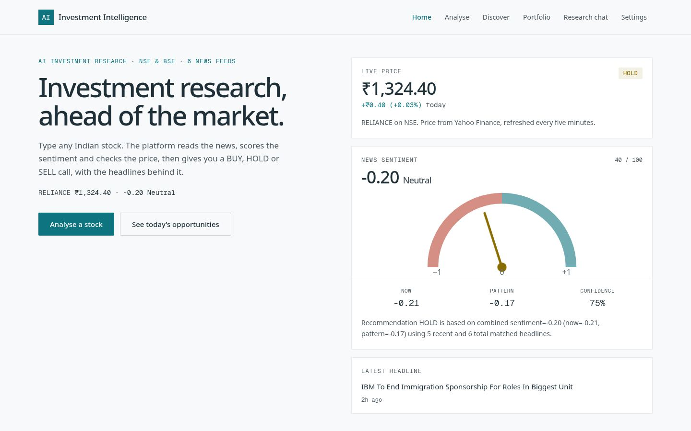
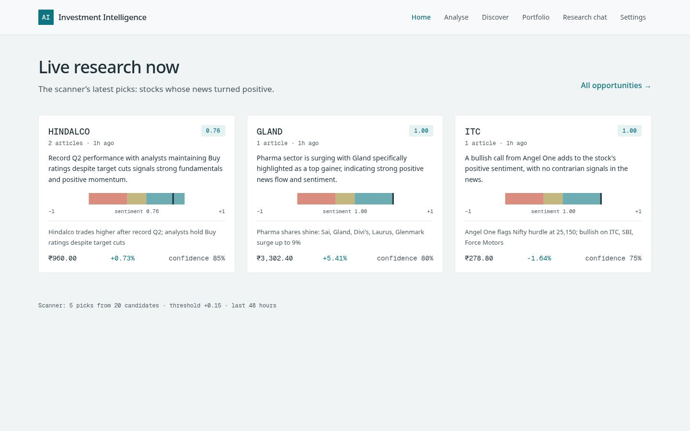
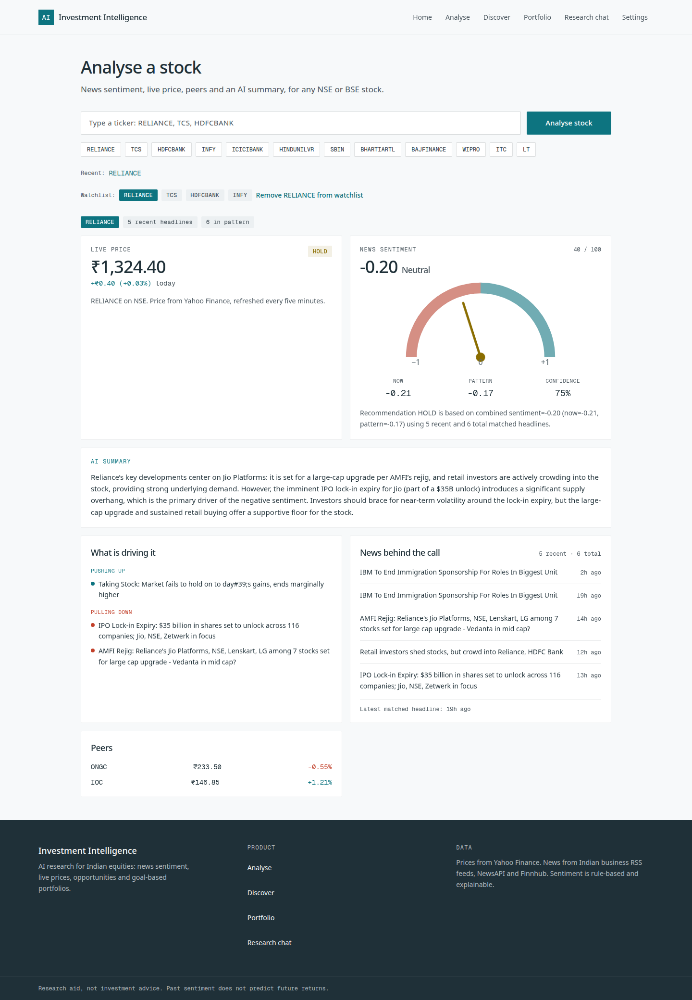
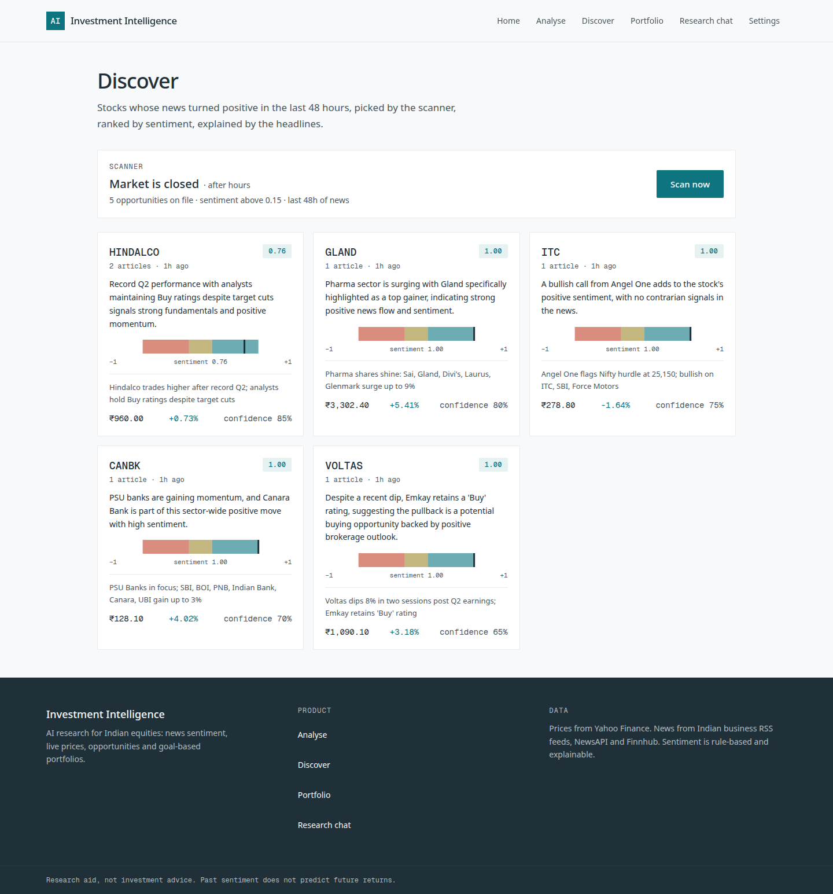
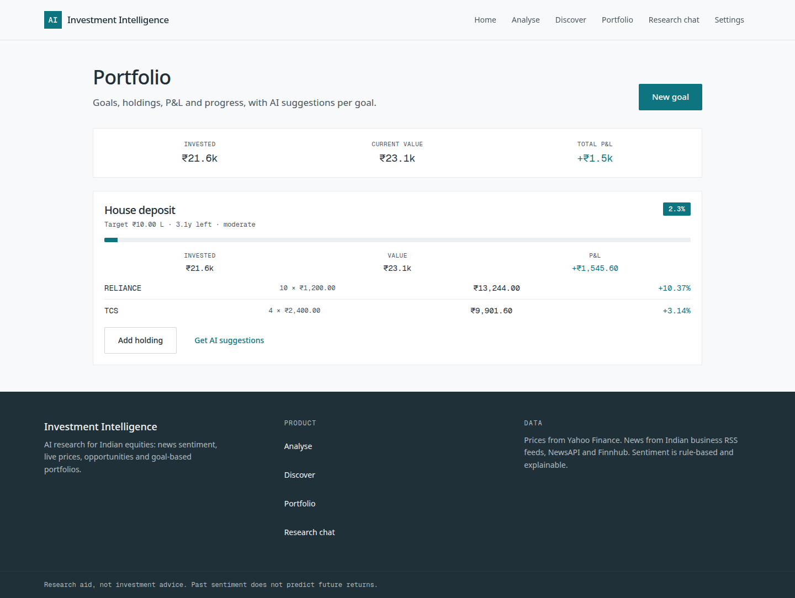
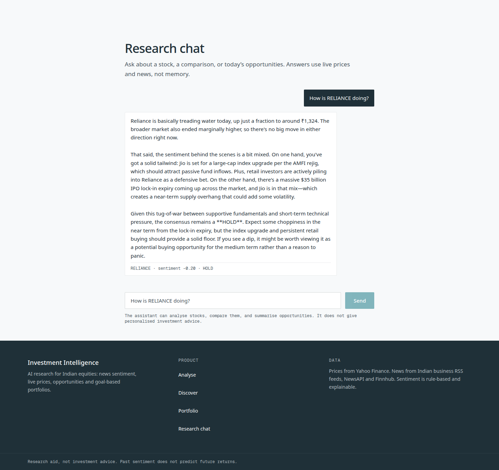
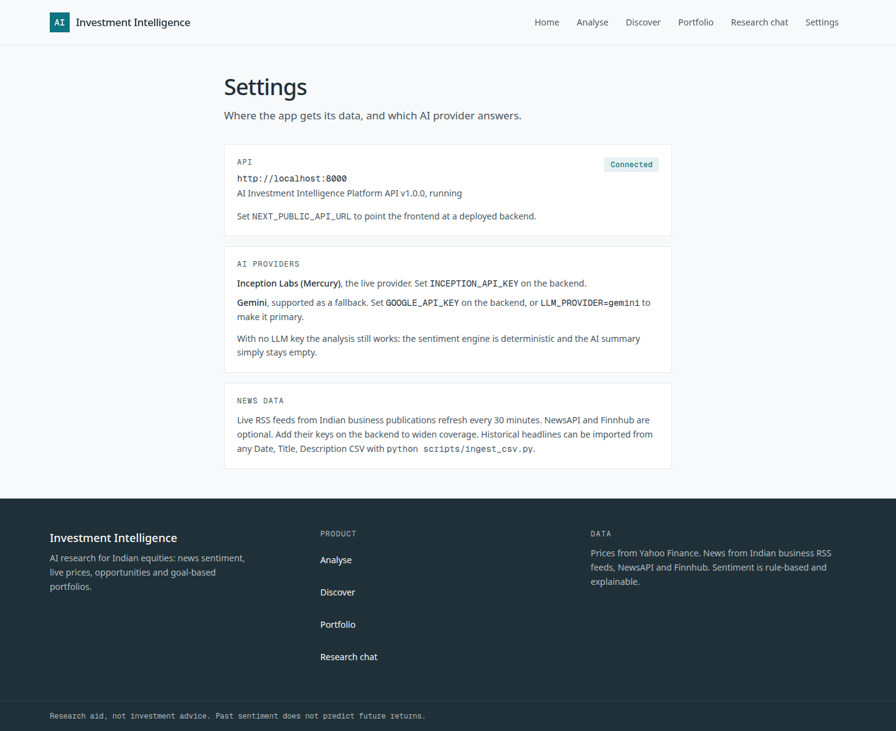
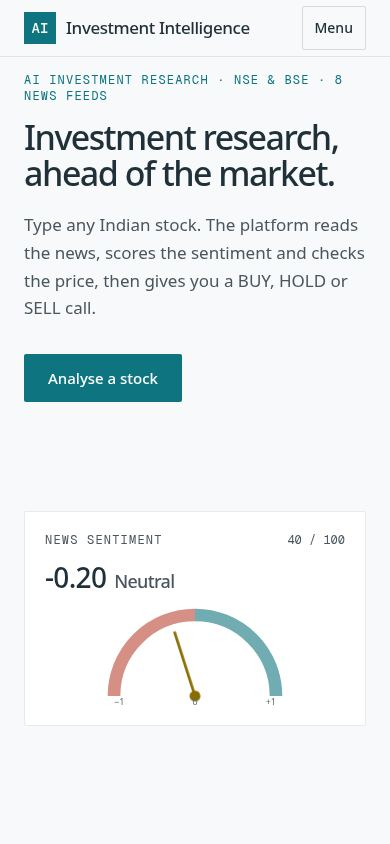

# AI Investment Intelligence Platform

AI research for Indian equities: news-driven sentiment, live prices,
opportunity scans and goal-based portfolios for NSE and BSE stocks.

Type any Indian stock. The platform reads the news about it, scores the
sentiment with an explainable rule-based engine, checks the live price, and
gives a BUY, HOLD or SELL call — with the headlines behind it.

## What it does

- **Analyse** — sentiment (now vs pattern), live price and peers, the drivers
  behind the call, and a 2–3 sentence AI summary. BUY at +0.20 or above,
  SELL at −0.20 or below, HOLD in between.
- **Discover** — a scanner that reads the last 48 hours of news, filters for
  positive sentiment, and asks the LLM to pick the top 5 BUY opportunities
  with reasoning. Runs around market hours (IST), or on demand.
- **Portfolio** — goals with holdings, live P&L, progress towards the target,
  and AI suggestions per goal.
- **Research chat** — ask about a stock, compare two, or ask what today's
  opportunities are. Answers use live prices and news, not memory.
- **Live news** — Indian business RSS feeds refresh every 30 minutes
  (Economic Times, Moneycontrol, Business Standard, Livemint, Hindu Business
  Line, NDTV Profit), with optional NewsAPI and Finnhub keys for wider
  coverage.

## Screenshots

All from a running stack (backend + frontend, live data).

### Home





### Analyse



### Discover



### Portfolio



### Research chat



### Settings



### Home on a phone



## How it works

```
news (RSS / NewsAPI / Finnhub)
  → ticker tagging (company names + ALL-CAPS symbols)
  → ChromaDB vector store (all-MiniLM-L6-v2, 384-dim)
  → sentiment engine (weighted lexicon, intensifiers, negation, contrast)
  → FastAPI → Next.js frontend
```

The sentiment engine is deterministic and explainable: every score traces
back to the words that produced it. There is no black box, and no LangGraph
— the analysis path is plain functions (fast path by default), which keeps
it fast and debuggable. The LLM is used only for summaries, chat, scanner
selection and portfolio suggestions.

**LLM providers** — Inception Labs (Mercury) is the live provider,
OpenAI-compatible. Gemini is supported as a second provider and fallback.
With no LLM key the analysis still works; the AI summary simply stays empty.

## Quick start

### Backend

```bash
python -m venv .venv && source .venv/bin/activate
pip install -r backend/requirements.txt
cp .env.example .env   # set INCEPTION_API_KEY (and GOOGLE_API_KEY for Gemini)
python scripts/build_seed_csv.py        # seed headlines from live RSS
python scripts/ingest_csv.py data/seed_news.csv
uvicorn main:app --app-dir backend --host 0.0.0.0 --port 8000
```

### Frontend

```bash
cd frontend-next
npm install
npm run build
npm run start   # or serve the static export in out/ (e.g. GitHub Pages)
```

The frontend talks to the API at `NEXT_PUBLIC_API_URL`
(default `http://localhost:8000`).

### Docker

```bash
docker compose up --build
```

The API listens on `:8000`, the frontend on `:3000`.

## Configuration

| Variable | Default | What it does |
| --- | --- | --- |
| `INCEPTION_API_KEY` | — | Inception Labs key (Mercury). The live provider. |
| `INCEPTION_BASE_URL` | `https://api.inceptionlabs.ai/v1` | Inception API base URL. |
| `INCEPTION_MODEL` | `mercury-3` | Mercury model for chat, summaries and scanning. |
| `GOOGLE_API_KEY` | — | Gemini key. Optional second provider / fallback. |
| `LLM_PROVIDER` | `inception` | Which provider is primary. |
| `USE_GENAI_ANALYSIS` | `false` | GenAI analysis path instead of the deterministic fast path. |
| `ENABLE_AI_SUMMARY` | `true` | 2–3 sentence AI summary on each analysis. |
| `NEWSAPI_KEY` / `FINNHUB_API_KEY` | — | Optional wider news coverage. |
| `ADMIN_API_KEY` | — | Key for `/admin/*`. When unset, admin endpoints are open (dev only). |
| `NEXT_PUBLIC_API_URL` | `http://localhost:8000` | API base URL for the frontend. |

## API

| Endpoint | What it does |
| --- | --- |
| `POST /analyze` | `{ticker}` → sentiment, price, peers, drivers, AI summary |
| `POST /chat` | Research chat (`message`, `session_id`, optional portfolio context) |
| `GET /opportunities` | Latest scanner picks |
| `POST /opportunities/scan` | Run a scan now |
| `GET /opportunities/status` | Scanner state and market-hours mode |
| `POST /portfolio/analyze` | Goals → P&L, progress, per-holding prices |
| `POST /portfolio/suggest` | AI suggestions for one goal |
| `POST /storage/portfolio/save` · `GET /storage/portfolio/load` | Persist goals |
| `POST /admin/live-news/refresh` · `POST /admin/live-news/retag-existing` | Ingest / re-tag news |

## Tests

```bash
python -m pytest backend/tests -q   # 34 tests: sentiment, tagging, scanner, API
cd frontend-next && npx tsc --noEmit && npm run build
```

## Data note

The seed data (`data/seed_news.csv`) is built from live public RSS feeds
by `scripts/build_seed_csv.py`, and the live ingestor keeps the store fresh
every 30 minutes. Coverage is therefore strongest for the recent window
that drives decisions.

## Licence

MIT. Research aid, not investment advice. Past sentiment does not predict
future returns.
